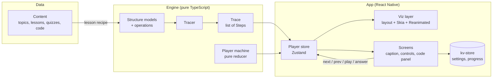

# ARCHITECTURE

How Visual-DSA is put together. This document builds on [TECH-STACK.md](./TECH-STACK.md) (the libraries), [VISUAL-SPEC.md](./VISUAL-SPEC.md) (the look) and [ALGORITHM-CATALOG.md](./ALGORITHM-CATALOG.md) (the content).

---

## 1. Goals and constraints

| Goal | What it means for the architecture |
|---|---|
| **Smooth 60fps visualisations on mid-range phones** | Animation runs on the UI thread (Reanimated + Skia). The JS thread only decides *what* the next state is, never *how* each frame looks. |
| **Step back, scrub and replay for free** | Every animation is driven by a precomputed list of **snapshots**, not by imperative "move this box" commands. |
| **Algorithms correct and testable** | The algorithm code is pure TypeScript with no React or React Native imports, so it's unit-tested in isolation. |
| **New topics without new engine code** | Lessons, quizzes and code samples are **data**. A topic reuses an existing renderer wherever it can. |
| **Offline-first, no backend** | All content ships in the app bundle. Progress is stored on the device in `expo-sqlite/kv-store`. |
| **Runs in Expo Go** | Only libraries included in Expo Go. No custom native modules or config plugins during development (TECH-STACK §1). |
| **No hard-coded values** | How things look comes from design tokens and how they behave comes from config. Code files only reference names (§9). |
| **One engine, four modes** | Learn, Play (sandbox), Practice and Compare all run on the same trace and player. |

---

## 2. The big picture



**The flow in one sentence:** content describes *what* to show → the engine runs the real algorithm and records a **trace** of snapshots → the player store tracks *which* step is on screen → the viz layer lays that step out and animates from the previous one.

---

## 3. Folder structure

The project follows the Expo project-structure conventions: app code lives under `src/`, `src/app` holds routes only, file names are kebab-case, and tests sit next to the code they test. This replaces the rough route sketch in TECH-STACK.md §2.

```
├── assets/                         # app icon, splash, static images
├── scripts/
│   ├── tsconfig.json               # scripts get Node types; checked by `bun run typecheck`
│   ├── highlight-code.ts           # Shiki → pre-tokenised code JSON
│   └── validate-content.ts         # Zod-checks every topic, run in CI
├── src/
│   ├── app/                        # Expo Router routes ONLY
│   │   ├── _layout.tsx             #   root: fonts, theme, stores hydrated
│   │   ├── (tabs)/
│   │   │   ├── _layout.tsx         #   Learn · Practice · Progress · Settings
│   │   │   ├── index.tsx           #   Home
│   │   │   ├── practice.tsx
│   │   │   ├── progress.tsx
│   │   │   └── settings.tsx
│   │   └── topic/[topicId]/
│   │       ├── _layout.tsx         #   stack for the topic
│   │       ├── index.tsx           #   Topic detail
│   │       ├── learn.tsx           #   Lesson player (?step=N)
│   │       ├── play.tsx            #   Sandbox
│   │       ├── practice.tsx        #   Topic quiz
│   │       ├── chapters.tsx        #   form sheet
│   │       └── reference.tsx       #   form sheet
│   │
│   ├── screens/                    # screen bodies rendered by routes
│   │   ├── home/                   #   Learn tab
│   │   ├── practice-hub/           #   Practice tab (quizzes, revise list)
│   │   ├── progress/
│   │   ├── settings/
│   │   ├── topic/
│   │   ├── lesson/                 #   player layout, caption, controls
│   │   ├── sandbox/                #   Play mode screen, value-input.ts (Zod + engine limits)
│   │   ├── practice/               #   one topic's quiz
│   │   ├── chapters/               #   form sheet
│   │   ├── reference/              #   form sheet
│   │   └── dev/                    #   dev-only showcases (tokens, components)
│   │
│   ├── components/                 # shared UI from VISUAL-SPEC §6
│   │   ├── app-text.tsx            #   ALL text: variant / weight / tone props
│   │   ├── pressable-scale.tsx     #   press feedback for every button (0.97 scale)
│   │   ├── button.tsx              #   primary / tinted / mode × md / compact / pill
│   │   ├── icon-button.tsx         #   ghost / round / step / play
│   │   ├── icon.tsx                #   Phosphor wrapper (token colours)
│   │   ├── icons.ts                #   icon registry by meaning
│   │   ├── chip.tsx · progress-bar.tsx · scrubber.tsx · stat-strip.tsx
│   │   ├── text-field.tsx · caption-text.tsx
│   │   ├── topic-card.tsx · topic-row.tsx · chapter-row.tsx · continue-card.tsx
│   │   ├── feedback-panel.tsx
│   │   ├── topic-art/              #   per-topic line drawings for Home's cards
│   │   └── topic-glyph/            #   custom category glyphs
│   │
│   ├── viz/                        # visualisation layer (React + Skia)
│   │   ├── canvas/                 #   VizCanvas, animated elements, gestures
│   │   ├── renderers/              #   one folder per renderer
│   │   │   ├── array/              #     layout.ts, layout.test.ts, renderer.tsx
│   │   │   ├── linked-list/
│   │   │   ├── stack/
│   │   │   ├── queue/
│   │   │   ├── hash-table/
│   │   │   ├── growth-chart/
│   │   │   └── registry.ts         #     renderer id → component
│   │   ├── scenes/                 #   hand-built analogy scenes (browser-back…)
│   │   ├── code-panel/
│   │   └── state-style.ts          #   element state → colour tokens
│   │
│   ├── engine/                     # PURE TypeScript: no React / RN imports
│   │   ├── core/                   #   types, tracer, scene builders, rng, limits,
│   │   │                           #   renderer.ts (RENDERER_IDS)
│   │   ├── structures/             #   array/, linked-list/, stack/, queue/, hash-table/
│   │   │   └── stack/              #     model.ts, operations.ts, to-scene.ts,
│   │   │                           #     describe.ts, operations.test.ts
│   │   ├── algorithms/             #   sorting/, searching/ (P1)
│   │   ├── lesson/                 #   lesson compiler (recipe → steps), STRUCTURES
│   │   ├── sandbox/                #   sandbox session: run, undo, reset, presets
│   │   └── player/                 #   player state machine (pure reducer)
│   │
│   ├── content/                    # DATA: no logic beyond small helpers
│   │   ├── schema.ts               #   Zod schemas for every content type
│   │   ├── registry.ts             #   TOPIC_IDS (Home order), metas, lookups;
│   │   │                           #   lazy loaders for lessons/quizzes as they arrive
│   │   ├── validate.ts             #   shared by the CLI and the content tests
│   │   ├── topics/
│   │   │   └── hash-table/
│   │   │       ├── meta.ts         #     title, category, chapters, renderer
│   │   │       ├── lesson.ts       #     lesson recipe
│   │   │       ├── sandbox.ts      #     Play mode: operations, presets, stats
│   │   │       ├── quiz.ts
│   │   │       ├── reference.ts
│   │   │       └── code/           #     one sample per language: hash-table.pseudo,
│   │   │                           #     hash-table.js (with @line markers)
│   │   ├── code.ts                 #   getCodeSample(topicId, language)
│   │   ├── code-types.ts           #   CodeSample, CodeRole (shared with the highlight script)
│   │   └── generated/              #   build output (code-tokens.json), git-ignored
│   │
│   ├── stores/                     # Zustand stores
│   │   ├── storage.ts              #   expo-sqlite/kv-store adapter for persist
│   │   ├── settings.ts             #   theme, code language, speed, haptics, reduced motion
│   │   ├── progress.ts             #   per-topic chapters and last position
│   │   └── create-player-store.ts  #   factory, one store per player instance
│   │
│   ├── theme/                      # DESIGN TOKENS: how it looks (§9.1)
│   │   ├── tokens.css              #   THE place to change colours, fonts, sizes
│   │   ├── fonts.ts                #   font files for useFonts (keys = --font-* names)
│   │   └── index.ts                #   typed token access for TS (Skia, icons, @expo/ui)
│   │
│   ├── config/                     # CONFIG: how it behaves (§9.2)
│   │   ├── index.ts                #   exports one frozen `config` object
│   │   ├── app.ts                  #   name, scheme, code languages, links
│   │   ├── player.ts               #   step duration, speeds, swipe threshold
│   │   ├── motion.ts               #   durations, springs, press scale
│   │   ├── engine.ts               #   step limits, input sizes, value ranges
│   │   ├── sandbox.ts              #   undo depth
│   │   ├── practice.ts             #   quiz length, revise-list size
│   │   ├── storage.ts              #   storage keys, schema versions
│   │   └── features.ts             #   feature flags
│   │
│   ├── hooks/                      # use-lesson, use-reduced-motion, use-stores-hydrated,
│   │                               # use-topic-progress (store-backed from Step 6.2)…
│   └── utils/
├── global.css                      # only imports tailwind, uniwind, src/theme/tokens.css
├── app.json
├── eas.json
└── package.json
```

### Dependency rules

```
engine  ←  content  ←  viz  ←  screens  ←  app
   ↑                     ↑        ↑
   └──── stores ─────────┴────────┘
```

- `config/` and `theme/` are leaf modules: they import nothing from the app.
- `engine/` imports **nothing** from the rest of the app except `config/`, and nothing from React or React Native.
- Only `viz/`, `components/` and `screens/` may import `theme/`.
- `content/` may import engine *types* and operation ids, never UI.
- `viz/` never imports `content/` directly. It receives scenes.
- Route files in `app/` only read params and render a screen.
- These rules are enforced with ESLint `no-restricted-imports` per folder.

---

## 4. Core data model

All of these types live in `src/engine/core/types.ts`.

### 4.1 Scene: what is on the canvas at one moment

A scene describes the visualisation without any layout or pixels. Every element has a **stable id**, so the viz layer can tell what moved, appeared, disappeared or changed state between two steps.

```ts
type ElementState =
  | 'default' | 'active' | 'new' | 'collision' | 'swapping'
  | 'visited' | 'found' | 'sorted' | 'error' | 'dimmed';

type SceneElement =
  | { kind: 'cell';    id: string; value: string; detail?: string; state: ElementState; slot: Slot }
  | { kind: 'edge';    id: string; from: string; to: string; directed: boolean; weight?: string; state: ElementState }
  | { kind: 'pointer'; id: string; label: string; target: string }   // "top", "j", "head"
  | { kind: 'callout'; id: string; text: string; anchor?: string }    // h("Sid") = 2
  | { kind: 'marker';  id: string; target: string; text: string };    // index labels, tombstones

type Slot =
  | { type: 'index'; index: number }                       // array, stack, queue
  | { type: 'bucket'; bucket: number; chainIndex: number } // hash table
  | { type: 'node' }                                       // list, tree, graph (laid out by renderer)
  | { type: 'input'; index: number };                      // a character of an input read left to right

interface Scene {
  renderer: RendererId;              // 'array' | 'linked-list' | 'stack' | …
  elements: SceneElement[];
  meta?: Record<string, number | string>;   // capacity, size, loadFactor…
}
```

### 4.2 Step and trace: one moment, and the whole run

```ts
interface Step {
  scene: Scene;                      // full snapshot (not a diff)
  caption: Caption;                  // what the learner reads
  codeLine?: string;                 // language-independent line id, e.g. 'cmp'
  vars?: Record<string, string>;     // live variables: { i: '3', top: '42' }
  counters?: { comparisons: number; swaps: number; reads: number; writes: number };
  a11y: string;                      // screen-reader summary of the scene
  pause?: 'chapter-end' | 'interactive' | 'predict';
}

type Caption =
  | { text: string }                                             // authored in a lesson
  | { key: string; params?: Record<string, string | number> };  // engine template, translatable

interface Trace {
  operation: string;                 // 'hash-table.put'
  steps: Step[];
  result?: unknown;                  // return value (pop → 42)
  error?: { code: string; message: Caption };  // overflow, not-found…
}
```

**Why full snapshots instead of diffs:** the data in this app is small (VISUAL-SPEC caps it at 6–12 elements per structure), so a 70-step lesson is a few hundred kilobytes at most. In return, jumping to any step is O(1), stepping back needs no "undo" logic, and the animation is just a comparison of step N−1 with step N.

### 4.3 Content types

```ts
interface TopicMeta {
  id: string;                        // 'hash-table' (kebab-case)
  title: string;
  summary: string;                   // one sentence for the Topic screen
  category: 'foundations' | 'linear' | 'hashing' | 'trees' | 'graphs' | 'algorithms';
  glyph: string;                     // topic glyph name (components/topic-glyph/glyphs.ts)
  priority: 'P0' | 'P1' | 'P2';
  renderer: RendererId;
  chapters: { id: string; title: string }[];
  complexity: { label: string; value: string }[];   // stat strip
}

interface LessonRecipe {
  topicId: string;
  segments: LessonSegment[];
}

type LessonSegment =
  | { kind: 'chapter'; chapterId: string }                         // chapter boundary
  | { kind: 'setup'; structure: string; input?: unknown }          // create or reset a structure
  | { kind: 'trace'; operation: string; input?: unknown;           // run real engine code
      captions?: Record<string, string> }                          // keyed by step number
  | { kind: 'scene'; sceneId: string; steps: { caption: string }[] } // analogy scene
  | { kind: 'say'; caption: string }                               // caption over the current scene
  | { kind: 'interactive'; prompt: string; expect?: InteractiveExpectation }
  | { kind: 'predict'; questionId: string };                       // inline prediction
```

All content is validated by the Zod schemas in `content/schema.ts`. The engine can't import content, so `engine/lesson/recipe.ts` declares the same recipe shape as `RecipeSegment`. `TOPIC_LESSONS` in `content/registry.ts` is typed as both, so the typecheck fails if the two drift apart.

---

## 5. Engine

### 5.1 Structures and operations

Each structure folder in `engine/structures/<name>/` contains:

| File | Responsibility |
|---|---|
| `model.ts` | The real data structure (e.g. `HashTableModel` with buckets, size, strategy). Immutable updates. |
| `operations.ts` | Operations written as normal algorithm code that report progress to a `Tracer`. |
| `to-scene.ts` | `toScene(model, annotations) → Scene`: turns the model plus highlight annotations into a scene. |
| `describe.ts` | `describe(scene) → string`: the screen-reader summary for each step. |
| `*.test.ts` | Correctness of the operations and the shape of the trace. |

Each structure also exports one entry point that runs a single operation and returns `{ trace, model }`, e.g. `traceStack(model, { type: 'push', value: '42' })`. The lesson compiler (§5.4) and the sandbox (§6.4) call it. Models are immutable, items have stable ids that are never reused (so the canvas can animate them), and the operations file lists the code line ids and caption keys it emits. Code samples (§5.3) must use those ids. Stack (Step 3.3) is the reference implementation.

### 5.2 The tracer

Operations are written as ordinary, readable algorithm code. They call the tracer at each moment worth showing:

```ts
export function put(t: Tracer<HashTableModel, HashAnnotations>, key: string, value: string) {
  const i = hash(t.model, key);
  t.step({ line: 'hash', annotations: { bucket: i, callout: `h("${key}") = ${i}` },
           caption: { key: 'hash.hashed', params: { key, i } } });

  const bucket = t.model.buckets[i];
  if (bucket.length > 0) {
    t.step({ line: 'collision', annotations: { bucket: i, state: 'collision' },
             caption: { key: 'hash.collision', params: { key, other: bucket[0].key } } });
  }

  t.update((m) => insert(m, i, key, value));
  t.count('writes');
  t.step({ line: 'append', annotations: { node: key, state: 'new' },
           caption: { key: 'hash.inserted', params: { key, i } } });
}

// Run it: the trace, plus the final model the sandbox continues from.
const { trace, model } = runTrace(
  { operation: 'hash-table.put', model: table, toScene, describe },
  (t) => put(t, 'Sid', '555-0196'),
);
```

The tracer (`engine/core/tracer.ts`):
- holds the current model and calls `toScene(model, annotations)` on every `step()`, so every step is a full snapshot. `annotations` are the structure's own highlight type (active index, new node, callout…).
- changes the model only through `update(m => newModel)`. Models are immutable, so earlier snapshots stay valid.
- tracks counters (`comparisons`, `swaps`, `reads`, `writes`) for F-902, snapshotted on each step.
- records learner-facing failures with `fail(code, caption)`. This adds a final error step and sets `trace.error`. Overflow and not-found are lesson content, not exceptions.
- enforces **limits** (`engine/core/limits.ts`, values in `config.engine`): at most 2,000 steps per trace. `runTrace` turns hitting the limit into an `engine.step-limit` error step instead of throwing. Inputs are checked with `checkItemCount` (12 items) and `checkValue` (whole numbers 0–99). Breaking a rule produces an error step, not an alert.
- is **deterministic**: random inputs use a seeded RNG (`engine/core/rng.ts`, mulberry32, default seed in config), so a shared scenario (F-607) or a test always produces the same trace.

### 5.3 Code-line mapping

Steps reference a **line id** (`'hash'`, `'collision'`, `'append'`), not a line number. Each code sample marks its lines:

```js
function put(table, key, value) {
  const i = hash(key) % table.length;      // @line hash
  if (table[i].length > 0) {               // @line collision
    // collision: chain onto the bucket
  }
  table[i].push({ key, value });           // @line append
}
```

Each topic with code has `content/topics/<topic>/code/` with **one file per language** in `config.app.codeLanguages` (`.pseudo` for pseudocode, `.js` for JavaScript). A file holds the whole implementation (every operation), so Copy gives the learner something complete and the panel shows the operation in context. Markers use `// @line <id>` (or `# @line <id>`). The same id may mark several lines, which then highlight together (e.g. `top = top + 1` and `items[top] = value` are both `push`). Each id belongs to one operation, so the panel never highlights the wrong method. That's why a failed `peek` reports `peek-empty`, not pop's `underflow`.

`scripts/highlight-code.ts` (`bun run highlight`) strips the markers, tokenises each file with Shiki (JavaScript built in, pseudocode from a small TextMate grammar in `scripts/lib/code-tokens.ts`), and writes `src/content/generated/code-tokens.json`: topic → language → `{ source, lines, lineIds }`. Each line is a list of `[text, role]` runs. Shiki's colours are thrown away: a token's TextMate scopes give it one of six roles (`plain`, `keyword`, `name`, `string`, `number`, `comment`), and the code panel colours roles from `tokens.css`, so code follows the theme like everything else. `lineIds` maps an id to 0-based line indices, e.g. `{ 'check-full': [7], pop: [18, 19] }`. Switching language keeps the highlight in sync, because the step's line id resolves in every language.

The JSON is git-ignored. It's rebuilt by `postinstall`, before every `start` script and before `validate:content`. Run `bun run highlight` after editing a sample while Metro is running. `validate:content` checks that every line id a lesson's steps use is marked in every language (`content/validate.ts`, `validateCodeLines`).

### 5.4 Lesson compiler

`engine/lesson/compile.ts` turns a `LessonRecipe` into a flat `CompiledLesson`:

```ts
compileLesson(recipe: LessonRecipeInput, chapterTitles: Record<string, string>): CompiledLesson

interface CompiledLesson {
  topicId: string;
  steps: Step[];
  chapters: { id: string; title: string; firstStep: number }[];
}
```

- `setup` segments create (or reset) a structure from its input, e.g. `{ structure: 'stack', input: { capacity: 4 } }`. They add no steps. The structure stays until the next `setup`, across chapters.
- `trace` segments (`'<structure>.<operation>'`) run the **real** operation on that structure's current model and append its steps. Authored `captions`, keyed by step number within the trace, replace the engine's template captions.
- `say` segments repeat the current structure at rest with a new caption, keeping the last counters. `interactive` does the same with `pause: 'interactive'`, and `predict` with `pause: 'predict'` and the `lesson.predict` caption.
- `scene` segments append one step per caption, drawn by the `analogy` renderer from hand-built scenes (`meta: { sceneId, sceneStep }`).
- The last step of each chapter gets `pause: 'chapter-end'`, unless it already pauses for input.
- The structures a recipe can use are registered in `engine/lesson/structures.ts` (`STRUCTURES`), each with `create`, `toScene`, `describe` and its operations. Recipe input is untrusted, so each one is checked there. Today: `stack` (`push`, `pop`, `peek`, `clear`) and `brackets` (`{ expression }`, `check`: the balanced-brackets checker in `engine/structures/stack/brackets.ts`, drawn by the stack renderer with the expression as a row of `input` cells above the stack).
- `scene` captions double as the step's screen-reader text, with the `**` bold marks removed.
- Anything wrong throws a `CompileError` with `at` (e.g. `segments[4]`) and a `reason`: an unknown chapter, structure or operation, a chapter that's repeated or empty, a step before any `setup`, a caption for a step the trace doesn't have, or bad input. `bun run validate:content` compiles every registered lesson, so these fail before release.
- Compilation is fast (milliseconds), so `getLesson()` runs it on device the first time a lesson opens and memoises the result. `content/lessons.test.ts` snapshots a readable outline of every lesson (caption, code line, screen-reader text and pause per step), so any change to an algorithm that changes a lesson shows up in review.

### 5.5 Player state machine

`engine/player/machine.ts` is a pure reducer with no timers and no React:

```
         play                 step timer
 paused ───────▶ playing ──────────────▶ playing (index + 1)
   ▲   ◀───────     │
   │    pause       │ reaches a step with `pause`
   │                ▼
   │          awaiting-input ── answer / continue ──▶ paused | playing
   │                │
   └── seek / next / prev (from any state, clamps to bounds)
                    │
              last step ──▶ ended
```

State: `{ index, status, speed, totalSteps, pauses, pauseAtChapterEnd, resumePlaying }`, created from the trace's per-step pause reasons with `createPlayerState`. Actions: `play`, `pause`, `next`, `prev`, `seek(index)`, `setSpeed(speed)`, `tick`, `answer`. Being pure means the playback rules are unit-tested (100% branch coverage) without rendering anything.

**Rules** (`engine/player/machine.ts`):
- **`tick`** (the step timer) only moves while playing. Past the last step the lesson is `ended`.
- **Chapter ends:** autoplay stops on a `chapter-end` step (`config.player.pauseAtChapterEnd`).
- **`predict` / `interactive` steps** put the player in `awaiting-input`. `tick`, `next` and `play` are blocked until `answer`. After the answer it resumes playing if it was playing, and stays paused if the learner was stepping by hand. Checking whether the answer is right happens outside the machine (§6.5).
- **`next`** stops autoplay. On the last step it ends the lesson.
- **`prev` and `seek`** are review: they pause, clamp to the steps, and never re-ask a question.
- **`play`** after the end restarts from the first step.
- **`setSpeed`** only accepts the speeds in `config.player.speeds`.
- **Unchanged actions** return the same state object, so React can skip re-renders.
- **Display helpers:** `canGoBack`, `canGoForward` and `stepNumber`.

---

## 6. App layer

### 6.1 Player store

`stores/create-player-store.ts` creates **one Zustand store per player instance**, not a global store, because Compare mode (F-901) runs two players side by side.

```ts
// In a screen: one player for this component, kept in sync with the trace.
const player = usePlayer(trace.steps);
const step = useCurrentStep(player);          // re-renders only when the step changes
const status = usePlayerStatus(player);
const { play, pause, next, prev, seek, setSpeed } = playerActions(player);
```

- **`createPlayerStore({ steps, startIndex?, speed? })`** (vanilla Zustand) holds the machine state (§5.5) plus `steps`, with two actions. `dispatch(action)` runs the pure reducer, and skips the update when the reducer returns the same state. `load(steps, startIndex?)` swaps in a new trace and keeps the speed. `destroy()` stops the timer.
- **The step timer lives in the store.** While `playing`, a timeout dispatches `tick` after `config.player.baseStepMs / speed` (1,500ms at 1×: the 400ms move plus reading time). It's rescheduled whenever the index, status, speed or steps change, so a speed change restarts the countdown, and pausing or waiting for an answer stops it. Frames in between are animated on the UI thread, so a busy JS thread never causes stutter.
- **`usePlayer(steps)`** (`stores/use-player.ts`) creates the store once per component, loads a new trace into it when `steps` changes, and destroys it on unmount.
- **Selector hooks return single values** (`useCurrentStep`, `usePlayerStatus`, `usePlayerSpeed`, `useStepNumber`, `useTotalSteps`, `useCanGoBack`, `useCanGoForward`). Never a new object: in Zustand v5 that makes the component re-render forever. The caption, the controls and the canvas each re-render only when their own value changes.
- **(Step 6.2)** The current step index is mirrored to the URL (`learn?step=6`) and saved to the progress store for "Continue where you left off" (F-104).

### 6.2 Viz layer

```
Step N ─▶ layout(scene, sizes) ─▶ Drawable[] ─▶ VizCanvas ─▶ usePresence ─▶ one animated Skia
          (pure, per renderer)    box / text /                (keeps leaving    component per id
                                  line / path, stable ids     ids for exitMs)   (shared values)
```

1. **Layout** (`viz/renderers/<name>/layout.ts`, from Step 4.2) is a pure function: scene + token sizes → `Drawable[]` (`viz/canvas/types.ts`). There are four kinds: `box` (cell or node, value plus optional detail line), `text` (index, pointer name, callout), `line` (edge or arrow, with optional arrowhead) and `path` (a fixed shape such as the stack container). Sizes, gaps and wrapping follow VISUAL-SPEC §7. Trees and graphs use their own layout algorithms (TECH-STACK §3e). Layout functions are unit-tested.
2. **Presence** (`viz/canvas/use-presence.ts`) keeps a drawable whose id disappeared for the exit duration, marked `exiting`, in its old place, so it can fade out. It returns the same state when nothing left or came back, so a caller that builds a new array every render can't loop.
3. **Animation** (`viz/canvas/drawables.tsx`, `animated-values.ts`) gives each drawable its own Reanimated shared values (position, size, opacity, colour, stroke width) that animate whenever its target changes:
   - **present in both steps:** move and resize with ease-in-out, and restyle colours with a cross-fade.
   - **new:** fade in and grow from `enterScale` (0.9), around its centre.
   - **leaving:** fade out.
   - Durations come from `canvasTimings(speed, reducedMotion)` (`viz/canvas/timing.ts`, values in `config.motion.canvas`), divided by playback speed. Reduced motion means no movement or scaling, only 150ms fades.
4. **Drawing:** Skia components take the shared and derived values directly as props, so every frame runs on the UI thread and React only re-renders when the step changes.
5. **Colours** come from `viz/state-style.ts`, which maps each `ElementState` to fill, stroke and text colour tokens plus a non-colour cue (border weight, dash, dimming). The canvas reads all colour tokens with `useColors`, so it switches theme together with the UI and cross-fades when it does.
6. **Fonts:** `useVizFonts` loads the same mono files (`FONT_FILES['app-mono']`, `FONT_FILES['app-mono-medium']`) through Skia's `useFont`, at the `--viz-font-*` token sizes. Text is centred by measuring it.
7. **Sizes:** cell sizes, gaps, stroke widths, dash and arrow sizes come from `@theme static` tokens through `useVizSizes()`. Layout functions receive them as a parameter, so they stay pure and testable.
8. **Gestures** (P1): pinch and pan update a canvas transform. Taps are hit-tested against the layout result, which the graph editor (F-604) uses.
9. **Accessibility:** `VizCanvas` is a single accessible image whose label is the current step's `a11y` summary, announced on step change.

**Renderer registry:** `viz/renderers/registry.ts` maps a `RendererId` to its component. `SceneView` (`viz/scene-view.tsx`) draws any scene with the renderer it names, and shows a plain message for a renderer that doesn't exist yet. Each renderer is a pure `layout<Name>(scene, sizes)` returning drawables plus the content's natural size, wrapped in a component that hands them to `VizCanvas`. `VizCanvas` scales content down to fit its viewport (never up) and centres it (`viz/canvas/fit.ts`). Adding a topic that reuses an existing renderer needs no viz code at all. The stack renderer (Step 4.2) is the reference.

**Analogy scenes** (`viz/scenes/`) are hand-built real-world examples (browser back button, phone book). Each is an `AnalogyScene`: a `stepCount` and a pure `layout(step, sizes)` that returns drawables for one of its fixed pictures. They use the same drawables as the renderers, so the canvas animates between pictures for free (a page keeps its id while it slides from the browser window into the back stack). The `analogy` renderer looks the scene up in `SCENES` by `scene.meta.sceneId` and draws `meta.sceneStep`. Content can't import viz, so `bun run validate:content` (`scripts/lib/check-scenes.ts`) checks every lesson `scene` segment names a scene in `SCENES` and gives exactly `stepCount` captions.

### 6.2b Lesson screen (Step 4.4)

- **Captions:** the engine emits caption keys with params. `content/captions.ts` holds the text for each key, with `{param}` placeholders and `**bold**` for key terms. `captionText` fills a template, and `CaptionText` (`screens/lesson`) draws the bold runs with `<Strong>`. Authored lesson text is used as it is. A test checks that every key a lesson uses has text, with no placeholder left unfilled.
- **Lessons:** `getLesson(topicId)` (`hooks/use-lesson.ts`) returns a `CompiledLesson` (`engine/lesson/types.ts`: steps plus chapters with their first step), compiled from the topic's recipe in `TOPIC_LESSONS` (§5.4) the first time it's asked for, then cached. Topics without a recipe return `undefined`, and the player says the lesson comes later.
- **Gestures (Gesture Handler 3 hook API):** swipe the canvas left/right to step (`usePanGesture`, values in `config.player.swipe`: a 48pt swipe or a fast flick). Drag or tap the scrubber to seek. The scrubber is also an `adjustable` control for screen readers. The app root is wrapped in `GestureHandlerRootView`.
- **Chapter sheet → lesson:** the sheet is its own route. A chapter pick goes through a small shared store (`stores/lesson-navigation.ts`): the sheet records `{ topicId, chapterId }` and closes, and the open lesson seeks to that chapter's first step and clears the request. This doesn't rely on how route params merge when a sheet is dismissed. The lesson opens the sheet with `current=<chapterId>` so the current chapter is highlighted.

### 6.3 Code panel

`viz/code-panel/` (`CodePanel`) renders the pre-tokenised lines as native `<Text>` spans and highlights the lines that `step.codeLine` resolves to in the selected language, scrolling them to the middle (`scroll.ts`). It has language pills and Copy (`expo-clipboard`, the sample's `source`). viz can't import content, so it declares the sample shape again (`types.ts`); the lesson screen passes content's `CodeSample` in, and TypeScript checks the two match. The lesson screen owns whether it's open (`config.code.panelOpenByDefault`, toggled by the code button) and the language (`config.app.defaultCodeLanguage`; the settings store keeps the choice from Step 6.1). It docks below the canvas in portrait and beside it in landscape (`useWindowDimensions`, F-506). Live `vars` in a watch row (F-503) are P1.

### 6.4 Sandbox

A sandbox session (`engine/sandbox/session.ts`, pure) keeps the current model and a history:

```ts
type SandboxSession<Model> = {
  model: Model;                  // current structure
  history: Model[];              // models before each change, for Undo (config.sandbox.historyDepth)
  initial: Model;                // the preset loaded last, for Reset
  steps: Step[];                 // what the player shows: the last trace, or the model at rest
};
// startSession, applyOperation, undo, reset, loadPreset, canUndo
```

1. The user picks an operation and enters input. A value is checked with Zod (it must be a number) and then with the engine's `checkValue` (a whole number in `config.engine.valueRange`); a problem is explained under the field (`screens/sandbox/value-input.ts`), never ignored.
2. The engine runs that operation **from the current model** through `STRUCTURES` (`engine/lesson/structures.ts`, the same registry lessons use) and returns a trace.
3. A player store plays the trace at the learner's speed, and the final model becomes the new current model. Only a change is remembered for Undo, so a peek or a push that overflowed leaves nothing to undo.
4. Errors (overflow, underflow, not found) are steps in the trace with the `error` state (F-606), not alerts.
5. Undo, Reset and loading a preset show the structure at rest (`restingStep`, shared with the lesson compiler) with a caption: the preset's hint, or "Undone". Reset and loading a preset can themselves be undone.
6. Each topic's `content/topics/<topic>/sandbox.ts` (`SandboxSchema`) names the structure, the operations in button order (the first is the primary action; `input: 'value'` adds the value field and Random), the presets (setup input plus a hint; the first is where the sandbox opens) and the stat strip (keys read from the scene's `meta`, e.g. the stack's `size`, `capacity` and `top`). `validate:content` checks the structure and operations exist and every preset builds.

### 6.5 Practice

| Question type | How it works |
|---|---|
| Multiple choice / true-false | Static data in `quiz.ts`. |
| **Predict the next step** | References an operation + input + step index. The player pauses at that step (`awaiting-input`). The learner taps an element or an option, and the answer is checked against the **next step's scene**, so answers can't drift out of sync with the algorithm. |
| Order the steps (P2) | Shuffled captions from a compiled trace. |
| Complexity | Static data, with links to the reference sheet. |

Each answer is written to the progress store. Wrong answers are added to the revise list (F-706).

---

## 7. State and persistence

| Store | Contents | Persisted |
|---|---|---|
| `settings` | Theme override, code language, default speed, haptics, reduced-motion override | kv-store |
| `progress` | Per topic: completed chapters, last step, quiz scores, mastery · bookmarks · streak · revise list | kv-store |
| player (per instance) | Steps, machine state | No (re-created on open) |
| sandbox (per session) | Model, history | No |

- Persistence uses Zustand `persist` with an `expo-sqlite/kv-store` adapter (`stores/storage.ts`). Storage keys and schema versions come from `config.storage`. Reads use the kv-store's **synchronous** `getItemSync`, so a store is hydrated as soon as it's created and the first frame already shows the saved theme. Writes are asynchronous.
- Each persisted store has a `version` and a `migrate` function, so updates never wipe a learner's progress. Saved data is also checked with Zod on the way in (`parseSettings`, `parseProgress`): every field has a `.catch()` default, so a missing, invalid or old value falls back to its default instead of breaking the app. A schema change bumps the version and converts the old shape in `migrate`.
- The root layout waits for hydration (`hooks/use-stores-hydrated.ts`, a `useSyncExternalStore` over each store's `persist` API) as well as fonts before hiding the splash screen.
- **Settings in use:** the root layout applies `theme` with `setThemePreference` (Uniwind). The lesson player starts at `defaultSpeed` and opens the code panel in `codeLanguage`; changing either in a lesson saves it as the new default (F-1102, F-1103). `hooks/use-reduced-motion.ts` combines the device setting with the `reducedMotion` override (`system` / `on` / `off`), and every animated component uses it instead of Reanimated's `useReducedMotion`. `haptics` gates `PressableScale`'s haptic, on top of `config.features.haptics` (still off, P1); the Settings row only shows when that flag is on.
- **Settings screen** (`screens/settings`): grouped rows in the app's own style (`surface` cards, `overline` section titles) with native `@expo/ui` controls on the right: `Picker` (menu) for theme, code language, playback speed and reduced motion, `Switch` for haptics. Each control sits in a `Host` with `colorScheme` set to the app's active theme (it may differ from the device's) and `seedColor` set to `primary`.
- Progress is keyed by **topic id and chapter id**, never by step index, so editing a lesson (adding steps) doesn't break saved progress. "Continue" stores the chapter id plus the offset within that chapter.
- **Recording (Step 6.2):** the lesson player saves `{ chapterId, offset }` on every step (`savePosition`, which also sets `lastTopicId` and skips unchanged saves) and completes a chapter when the learner reaches its last step (`completeChapter`). Position maths is pure and tested in `engine/lesson/position.ts` (`positionAt`, `isChapterEnd`, `resumeIndex`, `startIndex`).
- **Resuming:** a lesson opened without `chapter` or `step` resumes at the saved position. `resumeIndex` clamps the offset to the chapter (lessons can get shorter), and moves a learner who stopped on a chapter's last step on to the next chapter. A saved chapter that no longer exists means "start from the beginning".
- **Reading:** `hooks/use-topic-progress.ts` turns the saved data into what screens show (`topicProgress`: completed ids plus a `resume` point with chapter title and "step x of y"; `topicStatus`, `chapterState`, `completedCount`, which ignores chapter ids the topic no longer has). Home's topic cards show each topic's progress (the Continue card was removed in the UI rework; `lastTopicId` is still saved for a future resume shortcut). The Topic screen's button is Start, Continue (resumes) or Review (a finished topic, from chapter 1). The chapter sheet marks finished chapters.

---

## 8. Navigation

| Route | Screen | Presentation |
|---|---|---|
| `/` | Home (`screens/home`) | Tab "Learn" |
| `/practice`, `/progress`, `/settings` | `screens/practice-hub`, `progress`, `settings` | Tabs |
| `/topic/[topicId]` | Topic detail | Stack push |
| `/topic/[topicId]/learn` (`?chapter=<id>`, `?step=N`) | Lesson player: resumes by default; `chapter` opens a chapter, `step` (1-based) opens a step and wins over both | Stack push (full screen) |
| `/topic/[topicId]/play` | Sandbox | Stack push |
| `/topic/[topicId]/practice` | Topic quiz | Stack push |
| `/topic/[topicId]/chapters` | Chapter index | Form sheet |
| `/topic/[topicId]/reference` | Reference sheet | Form sheet |
| `/dev/tokens`, `/dev/components` | Dev-only showcases | Stack push; production redirects to `/` |

Deep links come for free from Expo Router, e.g. `visualdsa://topic/hash-table/learn?step=6`. These are needed later for shared scenarios (F-607).

**Implementation notes (Step 2.1):**
- **Entry points:** `Stack` from `expo-router/stack`, and `Tabs` from `expo-router/js-tabs`. The root `Tabs` export is deprecated in SDK 58.
- **The tab bar is JS `Tabs`, not `NativeTabs`.** NativeTabs only accepts SF Symbols, Material symbols, images or font icons. Our tab bar uses Phosphor icons (filled when active) on both platforms, rendered with `<Icon>` and `<AppText variant="tab">`. Tab switches don't animate.
- **Sheets:** chapters and reference use `presentation: 'formSheet'` with a grabber and detents from `config.navigation.sheet`.
- **Typed routes:** `bun run start` generates `.expo/types/router.d.ts`, so typecheck then rejects unknown paths. Use the object form `{ pathname: '/topic/[topicId]/learn', params: { topicId } }`. `expo-env.d.ts` is committed (not ignored) so Expo's global types load on every machine.

---

## 9. Design tokens and configuration

**Rule: code files contain no hard-coded values.** Every value someone might want to change lives in exactly one of two places:

| Kind | Where | Examples |
|---|---|---|
| **Design tokens** (how it looks) | `src/theme/tokens.css` | Colours (light + dark), fonts, type sizes, spacing, radii, icon sizes, canvas cell/node sizes, stroke widths |
| **Config** (how it behaves) | `src/config/` | Step duration, speed options, animation timings and springs, engine limits, input ranges, quiz length, storage keys, schema versions, feature flags, links |

Lesson data (e.g. the input `[42, 17, 8, 23]` or the key "Sid") is **content**, and lives in `src/content/`.

### 9.1 Design tokens: `src/theme/tokens.css`

`global.css` holds only imports:

```css
@import 'tailwindcss';
@import 'uniwind';
@import './src/theme/tokens.css';
```

`tokens.css` has three parts (the syntax is verified against the Uniwind skill):

```css
/* 1. Colours: one block per theme. Every theme must define the same variables. */
@layer theme {
  :root {
    @variant light {
      --color-background: #FAF8F4;
      --color-ink: #22201C;
      --color-primary: #3554D9;
      --color-signal: #E8611F;
      /* …every colour token from VISUAL-SPEC §2 */
    }
    @variant dark {
      --color-background: #1A1917;
      --color-ink: #EEE9E0;
      --color-primary: #8199FF;
      --color-signal: #FF8044;
      /* …the same set of names */
    }
  }
}

/* 2. Tokens used through class names: font-sans, text-caption, p-6, rounded-lg */
@theme {
  --font-sans: 'app-sans';            /* role names; src/theme/fonts.ts picks the typeface */
  --font-sans-bold: 'app-sans-bold';
  --font-mono: 'app-mono';
  --text-caption: 19px;
  --radius-lg: 16px;
  /* …type scale, spacing, radii from VISUAL-SPEC §3–4 */
}

/* 3. Tokens read only from TypeScript (Skia canvas, icons) */
@theme static {
  --viz-cell-width: 46px;
  --viz-cell-height: 52px;
  --viz-edge-width: 1.5px;
  --icon-md: 22px;
  /* … */
}
```

- **Only our tokens exist.** `tokens.css` resets Tailwind's default radii (`--radius-*: initial`). Colours can't be reset the same way: `--color-*: initial` also removes the theme colours, and Uniwind then generates no colour classes at all (this silently broke every `bg-*`/`text-*` colour class until the UI rework). Instead, lint rejects Tailwind's default palette (`bg-red-500`, `text-white`). Spacing keeps Tailwind's multiplier with `--spacing: 4px`, which gives the 4pt grid (`p-6` = 24).
- **Every colour is readable from TypeScript.** Uniwind only exposes a variable to `useCSSVariable` if some class name uses it. The `@source inline(...)` lines at the end of `tokens.css` mark every colour as used, so the Skia canvas can read colours no screen uses yet. **When you add a colour token, also add it to the `@source inline` list and to `COLOR_TOKENS` in `src/theme/index.ts`.**
- **Screens** style with class names that reference tokens (`bg-surface text-ink rounded-lg p-6`). Arbitrary values such as `bg-[#3554D9]` or `p-[13px]` are not allowed.
- **TypeScript** code (Skia canvas, charts, icon colours, `@expo/ui` colour props) reads tokens only through `src/theme/index.ts`. It wraps `useCSSVariable` (inside components) and `Uniwind.getCSSVariable` (outside React) and returns typed, parsed values, e.g. `useColor('signal')` and `useVizSizes()`. No other file calls those APIs, so token parsing lives in one place.
- **Theme switching:** follows the system by default. The user override from the settings store calls `Uniwind.setTheme('light' | 'dark' | 'system')`.
- **To change a colour, size or font**, edit `tokens.css` and nothing else. Uniwind hot-reloads the imported file. **To add a theme later**, add one `@variant` block with the full set of variables and register it in `extraThemes` in the Metro config.

### 9.2 Config: `src/config/`

One file per area, combined into a single typed, frozen object:

```ts
// src/config/player.ts
export const player = {
  baseStepMs: 400,
  speeds: [0.25, 0.5, 1, 1.5, 2, 4],
  defaultSpeed: 1,
  swipeThresholdPx: 48,
} as const;

// src/config/index.ts
export const config = Object.freeze({ app, player, motion, engine, sandbox, practice, storage, features });
```

```ts
// usage anywhere
import { config } from '@/config';
const delay = config.player.baseStepMs / speed;
```

| File | Holds |
|---|---|
| `app.ts` | App name, deep-link scheme, code languages offered, default language, external links |
| `code.ts` | Code panel: open by default, how long the "copied" tick shows |
| `player.ts` | Base step duration, speed options, default speed, swipe threshold, pause at chapter end |
| `motion.ts` | Highlight/insert/fade durations, spring configs, press scale, reduced-motion fade |
| `engine.ts` | Max steps per trace, max input size per structure, allowed value range, default RNG seed |
| `sandbox.ts` | Undo history depth (capacities and presets are content, in each topic's `sandbox.ts`) |
| `navigation.ts` | Form-sheet detents and grabber |
| `structures.ts` | Per-structure defaults, e.g. stack capacity |
| `practice.ts` | Questions per quiz, revise-list limit |
| `storage.ts` | Storage keys and schema versions per store |
| `features.ts` | Feature flags (compare mode, narration, haptics…) |

### 9.3 Enforcement

These ESLint rules are set up in Step 0.3 so the policy can't drift:

| Rule | Applies to | Allowed only in |
|---|---|---|
| No colour literals (`#…`, `rgb(`, `hsl(`) | All of `src/` | `src/theme/` |
| No arbitrary Tailwind values (`-[` inside a class string) | All of `src/` | Nowhere |
| `no-magic-numbers` (ignores −1, 0, 1, 2) | All of `src/` | `src/config/`, `src/theme/`, `src/content/`, tests |

Numbers that are part of an algorithm's definition (heap child index `2i + 1`, `mid = (lo + hi) / 2`) are fine where they are. Anything a person might want to tune goes into config.

---

## 10. Build-time scripts

| Script | When | Output |
|---|---|---|
| `scripts/highlight-code.ts` (`bun run highlight`) | `postinstall`, before `start`/`start:tunnel`/`start:ngrok` and `validate:content`, and by hand after editing a sample. EAS builds run `postinstall` too | `src/content/generated/code-tokens.json` (git-ignored). Fails on an unknown file extension, a missing or second sample for a language, or a line id that isn't kebab-case |
| `scripts/validate-content.ts` (`bun run validate:content`) | CI and pre-commit | Fails if any topic breaks a Zod schema, is registered under the wrong id, has a folder that isn't registered, names a glyph that doesn't exist, has a sandbox whose structure, operations or presets don't work, has a lesson that doesn't compile (unknown chapter, structure or operation, bad input), highlights a code line that a language's sample doesn't mark, or has a `scene` segment whose scene doesn't exist or whose caption count doesn't match the scene's steps |

---

## 11. Errors and monitoring

- **Engine errors** that are part of the lesson (overflow, not found) are trace steps, not exceptions.
- **Unexpected errors:** each canvas is wrapped in an error boundary. The fallback says the step couldn't be drawn and offers Restart, while the caption and controls keep working.
- **Crash reporting:** Sentry is postponed (TECH-STACK §12). During development in Expo Go, errors show in the Expo dev tools. From the first release build, store-console crash reports and EAS Observe cover them. EAS Observe's error reporting could be added here later without a new vendor.
- **Content errors** are caught before release by `validate-content.ts` and compiled-lesson snapshot tests.

---

## 12. Performance budget

| Area | Budget |
|---|---|
| Frame rate during step animation | 60fps on a mid-range Android device (e.g. 2023 mid-tier) |
| Elements on the canvas | ≤ 300 (well above any planned lesson) |
| Lesson compile on first open | < 50ms for a 70-step lesson |
| Step change → animation start | < 16ms (one frame) |
| Cold start to interactive Home | < 2s on mid-range Android, tracked with EAS Observe |

Techniques: layout is memoised per step; per-element shared values are reused across steps; topic content is loaded lazily via `content/registry.ts`; the code panel only re-renders when the line id or language changes.

---

## 13. Adding a new topic

1. **Engine:** add `engine/structures/<topic>/` (or `algorithms/`) with model, operations, `toScene`, `describe` and tests. Skip this if the topic only adds new operations to an existing structure.
2. **Renderer:** reuse one from the registry. Add a new renderer only if none fits (ALGORITHM-CATALOG §9).
3. **Content:** add `content/topics/<topic>/` with `meta.ts`, `lesson.ts`, `quiz.ts`, `reference.ts`, and code samples with `@line` markers.
4. **Register** the topic in `content/registry.ts`.
5. **Verify:** run `validate-content`, update the compiled-lesson snapshot, and check the lesson on a small phone in both portrait and landscape.

---

## 14. Key decisions

| Decision | Chosen | Alternative rejected | Why |
|---|---|---|---|
| Animation model | Full snapshots + diff by element id | Imperative animation commands | Free reverse/scrub, simpler algorithms, easier tests |
| Algorithm code | Pure TS with a tracer | Algorithms written inside components | Testable, reusable across modes, deterministic |
| Lesson compilation | On device, memoised | Pre-generated JSON at build time | Keeps the bundle small; compile is fast; snapshot tests still guard changes |
| Code highlighting | Shiki at build time with line ids | Runtime highlighter | No parser on device; language-independent highlight sync |
| Player store | One store per instance | Global store | Compare mode needs two players at once |
| Progress keys | Topic + chapter ids | Step indices | Lessons can change without breaking saved progress |
| Drawing | Skia canvas | Views or SVG per element | Scales to large trees/graphs at 60fps |
| Tab bar | JS `Tabs` with Phosphor icons | `NativeTabs` | NativeTabs can't render our SVG icon set. JS tabs keep one consistent design on iOS and Android |
| Dev environment | Expo Go on a real phone | Development builds, simulators | Fast setup and testing on real hardware. Every library must be included in Expo Go |
| Storage | `expo-sqlite/kv-store` | MMKV | Included in Expo Go. MMKV needs a development build |
| Design tokens | One `tokens.css`, read by both class names and TS | Colours in TS theme files | One file to edit. Works for Uniwind classes and the Skia canvas |
| Constants | `src/config/` with lint enforcement | Values inline in code | Tunable without touching code. The lint rules stop drift |
