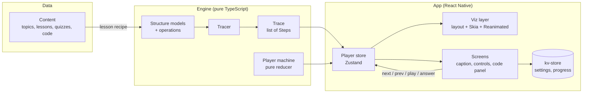

# ARCHITECTURE

How Visual-DSA is put together. This document builds on [TECH-STACK.md](./TECH-STACK.md) (the libraries), [VISUAL-SPEC.md](./VISUAL-SPEC.md) (the look) and [ALGORITHM-CATALOG.md](./ALGORITHM-CATALOG.md) (the content).

---

## 1. Goals and constraints

| Goal | What it means for the architecture |
|---|---|
| **Smooth 60fps visualisations on mid-range phones** | Animation runs on the UI thread (Reanimated + Skia). The JS thread only decides *what* the next state is, never *how* each frame looks. |
| **Step back, scrub and replay for free** | Every animation is driven by a precomputed list of **snapshots**, not by imperative "move this box" commands. |
| **Algorithms correct and testable** | The algorithm code is pure TypeScript with no React or React Native imports, so it's unit-tested in isolation. |
| **New topics without new engine code** | Lessons, quizzes and code samples are **data**. A topic reuses an existing renderer wherever it can. |
| **Offline-first, no backend** | All content ships in the app bundle. Progress is stored on the device in `expo-sqlite/kv-store`. |
| **Runs in Expo Go** | Only libraries included in Expo Go. No custom native modules or config plugins during development (TECH-STACK §1). |
| **No hard-coded values** | How things look comes from design tokens and how they behave comes from config. Code files only reference names (§9). |
| **One engine, four modes** | Learn, Play (sandbox), Practice and Compare all run on the same trace and player. |

---

## 2. The big picture



**The flow in one sentence:** content describes *what* to show → the engine runs the real algorithm and records a **trace** of snapshots → the player store tracks *which* step is on screen → the viz layer lays that step out and animates from the previous one.

---

## 3. Folder structure

The project follows the Expo project-structure conventions: app code lives under `src/`, `src/app` holds routes only, file names are kebab-case, and tests sit next to the code they test. This replaces the rough route sketch in TECH-STACK.md §2.

```
├── assets/                         # app icon, splash, static images
├── scripts/
│   ├── tsconfig.json               # scripts get Node types; checked by `bun run typecheck`
│   ├── highlight-code.ts           # Shiki → pre-tokenised code JSON
│   └── validate-content.ts         # Zod-checks every topic, run in CI
├── src/
│   ├── app/                        # Expo Router routes ONLY
│   │   ├── _layout.tsx             #   root: fonts, theme, stores hydrated
│   │   ├── (tabs)/
│   │   │   ├── _layout.tsx         #   Learn · Practice · Progress · Settings
│   │   │   ├── index.tsx           #   Home
│   │   │   ├── practice.tsx
│   │   │   ├── progress.tsx
│   │   │   └── settings.tsx
│   │   └── topic/[topicId]/
│   │       ├── _layout.tsx         #   stack for the topic
│   │       ├── index.tsx           #   Topic detail
│   │       ├── learn.tsx           #   Lesson player (?step=N)
│   │       ├── play.tsx            #   Sandbox
│   │       ├── practice.tsx        #   Topic quiz
│   │       ├── chapters.tsx        #   form sheet
│   │       └── reference.tsx       #   form sheet
│   │
│   ├── screens/                    # screen bodies rendered by routes
│   │   ├── home/                   #   Learn tab
│   │   ├── practice-hub/           #   Practice tab (quizzes, revise list)
│   │   ├── progress/
│   │   ├── settings/
│   │   ├── topic/
│   │   ├── lesson/                 #   player layout, caption, controls
│   │   ├── sandbox/                #   operation bar, inputs per structure
│   │   ├── practice/               #   one topic's quiz
│   │   ├── chapters/               #   form sheet
│   │   ├── reference/              #   form sheet
│   │   └── dev/                    #   dev-only showcases (tokens, components)
│   │
│   ├── components/                 # shared UI from VISUAL-SPEC §6
│   │   ├── app-text.tsx            #   ALL text: variant / weight / tone props
│   │   ├── pressable-scale.tsx     #   press feedback for every button (0.97 scale)
│   │   ├── button.tsx              #   primary / tinted / mode × md / compact / pill
│   │   ├── icon-button.tsx         #   ghost / round / step / play
│   │   ├── icon.tsx                #   Phosphor wrapper (token colours)
│   │   ├── icons.ts                #   icon registry by meaning
│   │   ├── chip.tsx · progress-bar.tsx · scrubber.tsx · stat-strip.tsx
│   │   ├── topic-row.tsx · chapter-row.tsx · continue-card.tsx · feedback-panel.tsx
│   │   └── topic-glyph/            #   custom category glyphs
│   │
│   ├── viz/                        # visualisation layer (React + Skia)
│   │   ├── canvas/                 #   VizCanvas, animated elements, gestures
│   │   ├── renderers/              #   one folder per renderer
│   │   │   ├── array/              #     layout.ts, layout.test.ts, renderer.tsx
│   │   │   ├── linked-list/
│   │   │   ├── stack/
│   │   │   ├── queue/
│   │   │   ├── hash-table/
│   │   │   ├── growth-chart/
│   │   │   └── registry.ts         #     renderer id → component
│   │   ├── scenes/                 #   hand-built analogy scenes (browser-back…)
│   │   ├── code-panel/
│   │   └── state-style.ts          #   element state → colour tokens
│   │
│   ├── engine/                     # PURE TypeScript: no React / RN imports
│   │   ├── core/                   #   types, tracer, scene builders, rng, limits,
│   │   │                           #   renderer.ts (RENDERER_IDS)
│   │   ├── structures/             #   array/, linked-list/, stack/, queue/, hash-table/
│   │   │   └── stack/              #     model.ts, operations.ts, to-scene.ts,
│   │   │                           #     describe.ts, operations.test.ts
│   │   ├── algorithms/             #   sorting/, searching/ (P1)
│   │   ├── lesson/                 #   lesson compiler (recipe → steps)
│   │   └── player/                 #   player state machine (pure reducer)
│   │
│   ├── content/                    # DATA: no logic beyond small helpers
│   │   ├── schema.ts               #   Zod schemas for every content type
│   │   ├── registry.ts             #   TOPIC_IDS (Home order), metas, lookups;
│   │   │                           #   lazy loaders for lessons/quizzes as they arrive
│   │   ├── validate.ts             #   shared by the CLI and the content tests
│   │   ├── topics/
│   │   │   └── hash-table/
│   │   │       ├── meta.ts         #     title, category, chapters, renderer
│   │   │       ├── lesson.ts       #     lesson recipe
│   │   │       ├── quiz.ts
│   │   │       ├── reference.ts
│   │   │       └── code/           #     put.pseudo, put.js … (with line ids)
│   │   └── generated/              #   build output (code tokens), git-ignored
│   │
│   ├── stores/                     # Zustand stores
│   │   ├── storage.ts              #   expo-sqlite/kv-store adapter for persist
│   │   ├── settings.ts
│   │   ├── progress.ts
│   │   └── create-player-store.ts  #   factory, one store per player instance
│   │
│   ├── theme/                      # DESIGN TOKENS: how it looks (§9.1)
│   │   ├── tokens.css              #   THE place to change colours, fonts, sizes
│   │   ├── fonts.ts                #   font files for useFonts (keys = --font-* names)
│   │   └── index.ts                #   typed token access for TS (Skia, icons, @expo/ui)
│   │
│   ├── config/                     # CONFIG: how it behaves (§9.2)
│   │   ├── index.ts                #   exports one frozen `config` object
│   │   ├── app.ts                  #   name, scheme, code languages, links
│   │   ├── player.ts               #   step duration, speeds, swipe threshold
│   │   ├── motion.ts               #   durations, springs, press scale
│   │   ├── engine.ts               #   step limits, input sizes, value ranges
│   │   ├── sandbox.ts              #   capacities, undo depth
│   │   ├── practice.ts             #   quiz length, revise-list size
│   │   ├── storage.ts              #   storage keys, schema versions
│   │   └── features.ts             #   feature flags
│   │
│   ├── hooks/                      # use-reduced-motion…
│   └── utils/
├── global.css                      # only imports tailwind, uniwind, src/theme/tokens.css
├── app.json
├── eas.json
└── package.json
```

### Dependency rules

```
engine  ←  content  ←  viz  ←  screens  ←  app
   ↑                     ↑        ↑
   └──── stores ─────────┴────────┘
```

- `config/` and `theme/` are leaf modules: they import nothing from the app.
- `engine/` imports **nothing** from the rest of the app except `config/`, and nothing from React or React Native.
- Only `viz/`, `components/` and `screens/` may import `theme/`.
- `content/` may import engine *types* and operation ids, never UI.
- `viz/` never imports `content/` directly. It receives scenes.
- Route files in `app/` only read params and render a screen.
- These rules are enforced with ESLint `no-restricted-imports` per folder.

---

## 4. Core data model

All of these types live in `src/engine/core/types.ts`.

### 4.1 Scene: what is on the canvas at one moment

A scene describes the visualisation without any layout or pixels. Every element has a **stable id**, so the viz layer can tell what moved, appeared, disappeared or changed state between two steps.

```ts
type ElementState =
  | 'default' | 'active' | 'new' | 'collision' | 'swapping'
  | 'visited' | 'found' | 'sorted' | 'error' | 'dimmed';

type SceneElement =
  | { kind: 'cell';    id: string; value: string; detail?: string; state: ElementState; slot: Slot }
  | { kind: 'edge';    id: string; from: string; to: string; directed: boolean; weight?: string; state: ElementState }
  | { kind: 'pointer'; id: string; label: string; target: string }   // "top", "j", "head"
  | { kind: 'callout'; id: string; text: string; anchor?: string }    // h("Sid") = 2
  | { kind: 'marker';  id: string; target: string; text: string };    // index labels, tombstones

type Slot =
  | { type: 'index'; index: number }                       // array, stack, queue
  | { type: 'bucket'; bucket: number; chainIndex: number } // hash table
  | { type: 'node' };                                      // list, tree, graph (laid out by renderer)

interface Scene {
  renderer: RendererId;              // 'array' | 'linked-list' | 'stack' | …
  elements: SceneElement[];
  meta?: Record<string, number | string>;   // capacity, size, loadFactor…
}
```

### 4.2 Step and trace: one moment, and the whole run

```ts
interface Step {
  scene: Scene;                      // full snapshot (not a diff)
  caption: Caption;                  // what the learner reads
  codeLine?: string;                 // language-independent line id, e.g. 'cmp'
  vars?: Record<string, string>;     // live variables: { i: '3', top: '42' }
  counters?: { comparisons: number; swaps: number; reads: number; writes: number };
  a11y: string;                      // screen-reader summary of the scene
  pause?: 'chapter-end' | 'interactive' | 'predict';
}

type Caption =
  | { text: string }                                             // authored in a lesson
  | { key: string; params?: Record<string, string | number> };  // engine template, translatable

interface Trace {
  operation: string;                 // 'hash-table.put'
  steps: Step[];
  result?: unknown;                  // return value (pop → 42)
  error?: { code: string; message: Caption };  // overflow, not-found…
}
```

**Why full snapshots instead of diffs:** the data in this app is small (VISUAL-SPEC caps it at 6–12 elements per structure), so a 70-step lesson is a few hundred kilobytes at most. In return, jumping to any step is O(1), stepping back needs no "undo" logic, and the animation is just a comparison of step N−1 with step N.

### 4.3 Content types

```ts
interface TopicMeta {
  id: string;                        // 'hash-table' (kebab-case)
  title: string;
  summary: string;                   // one sentence for the Topic screen
  category: 'foundations' | 'linear' | 'hashing' | 'trees' | 'graphs' | 'algorithms';
  glyph: string;                     // topic glyph name (components/topic-glyph/glyphs.ts)
  priority: 'P0' | 'P1' | 'P2';
  renderer: RendererId;
  chapters: { id: string; title: string }[];
  complexity: { label: string; value: string }[];   // stat strip
}

interface LessonRecipe {
  topicId: string;
  segments: LessonSegment[];
}

type LessonSegment =
  | { kind: 'chapter'; chapterId: string }                         // chapter boundary
  | { kind: 'trace'; operation: string; input: unknown;            // run real engine code
      captions?: Record<number, string>; from?: 'previous' | 'fresh' }
  | { kind: 'scene'; sceneId: string; steps: { caption: string }[] } // analogy scene
  | { kind: 'say'; caption: string }                               // caption over the current scene
  | { kind: 'interactive'; prompt: string; expect: InteractiveExpectation }
  | { kind: 'predict'; questionId: string };                       // inline prediction
```

All content is validated by the Zod schemas in `content/schema.ts`.

---

## 5. Engine

### 5.1 Structures and operations

Each structure folder in `engine/structures/<name>/` contains:

| File | Responsibility |
|---|---|
| `model.ts` | The real data structure (e.g. `HashTableModel` with buckets, size, strategy). Immutable updates. |
| `operations.ts` | Operations written as normal algorithm code that report progress to a `Tracer`. |
| `to-scene.ts` | `toScene(model, annotations) → Scene`: turns the model plus highlight annotations into a scene. |
| `describe.ts` | `describe(scene) → string`: the screen-reader summary for each step. |
| `*.test.ts` | Correctness of the operations and the shape of the trace. |

### 5.2 The tracer

Operations are written as ordinary, readable algorithm code. They call the tracer at each moment worth showing:

```ts
export function put(t: Tracer<HashTableModel>, key: string, value: string) {
  const i = t.model.hash(key);
  t.step({ line: 'hash', highlight: { bucket: i }, callout: `h("${key}") = ${i}`,
           caption: { key: 'hash.hashed', params: { key, i } } });

  const bucket = t.model.buckets[i];
  if (bucket.length > 0) {
    t.step({ line: 'collision', highlight: { bucket: i, state: 'collision' },
             caption: { key: 'hash.collision', params: { key, other: bucket[0].key } } });
  }

  t.update((m) => m.insert(i, key, value));
  t.count('writes');
  t.step({ line: 'append', highlight: { node: key, state: 'new' },
           caption: { key: 'hash.inserted', params: { key, i } } });
}
```

The tracer:
- holds the current model and calls `toScene` on every `step()`, so every step is a full snapshot.
- tracks counters (`comparisons`, `swaps`, `reads`, `writes`) for F-902.
- enforces **limits** (`engine/core/limits.ts`): a maximum number of steps per trace (2,000) and a maximum input size per structure. A sandbox input that would exceed them is rejected with a friendly error step.
- is **deterministic**: random inputs use a seeded RNG (`engine/core/rng.ts`), so a shared scenario (F-607) or a test always produces the same trace.

### 5.3 Code-line mapping

Steps reference a **line id** (`'hash'`, `'collision'`, `'append'`), not a line number. Each code sample marks its lines:

```js
function put(table, key, value) {
  const i = hash(key) % table.length;      // @line hash
  if (table[i].length > 0) {               // @line collision
    // collision: chain onto the bucket
  }
  table[i].push({ key, value });           // @line append
}
```

`scripts/highlight-code.ts` strips the markers, tokenises each file with Shiki, and writes `{ lines: Token[][], lineIds: { hash: 2, collision: 3, append: 6 } }` per language. Switching language keeps the highlight in sync, because the step's line id resolves in every language.

### 5.4 Lesson compiler

`engine/lesson/compile.ts` turns a `LessonRecipe` into a flat `CompiledLesson`:

```ts
interface CompiledLesson {
  steps: Step[];
  chapters: { id: string; title: string; firstStep: number }[];
}
```

- `trace` segments run the **real** operation on the current model and append its steps, with authored captions overriding the engine's template captions where given.
- `scene` segments append steps from hand-built analogy scenes (the browser back stack).
- `say` segments repeat the current scene with a new caption.
- Compilation is fast (milliseconds), so it runs on device the first time a lesson opens and is memoised. Compiled lessons are snapshot-tested, so any change to an algorithm that changes a lesson shows up in review.

### 5.5 Player state machine

`engine/player/machine.ts` is a pure reducer with no timers and no React:

```
         play                 step timer
 paused ───────▶ playing ──────────────▶ playing (index + 1)
   ▲   ◀───────     │
   │    pause       │ reaches a step with `pause`
   │                ▼
   │          awaiting-input ── answer / continue ──▶ paused | playing
   │                │
   └── seek / next / prev (from any state, clamps to bounds)
                    │
              last step ──▶ ended
```

State: `{ index, status, speed, totalSteps }`. Actions: `play`, `pause`, `next`, `prev`, `seek(n)`, `setSpeed(x)`, `tick`, `answer(value)`. Being pure means the playback rules are unit-tested without rendering anything.

---

## 6. App layer

### 6.1 Player store

`stores/create-player-store.ts` creates **one Zustand store per player instance**, not a global store, because Compare mode (F-901) runs two players side by side.

```ts
const store = createPlayerStore({ steps, chapters });
// state:   machine state + steps + chapters
// actions: dispatch(action), plus the step timer
```

- The **step timer** lives in the store. It runs a JS timeout of `stepDuration / speed` and dispatches `tick`. Frames in between are animated on the UI thread, so a busy JS thread never causes stutter.
- Components subscribe with selectors (`useStore(s => s.steps[s.index])`), so the caption, the controls and the canvas each re-render only when their own slice changes.
- The current step index is mirrored to the URL (`learn?step=6`) and saved to the progress store for "Continue where you left off" (F-104).

### 6.2 Viz layer

```
Step N-1 ─┐
          ├─▶ layout(scene, viewport) ─▶ positioned elements ─▶ useAnimatedElements ─▶ <Canvas> (Skia)
Step N  ──┘        (pure, per renderer)       {id, x, y, w, h, state}     shared values per id
```

1. **Layout** (`viz/renderers/<name>/layout.ts`) is a pure function: scene + viewport size → positioned elements. Sizes, gaps and wrapping follow VISUAL-SPEC §7. Trees and graphs use their own layout algorithms (TECH-STACK §3e). Layout functions are unit-tested.
2. **Animation** (`viz/canvas/use-animated-elements.ts`) keeps one set of Reanimated shared values per element id (x, y, opacity, colour):
   - **present in both steps:** animate to the new position/style (spring for moves, timing for colour).
   - **new in step N:** enter (scale 0.9 → 1 with fade).
   - **gone in step N:** exit (fade out), then removed.
   - Durations come from VISUAL-SPEC §8, scaled by playback speed. Reduced motion switches every transition to a 150ms cross-fade.
3. **Drawing** (`renderer.tsx`) draws with Skia components that read the shared values directly, so there is no React re-render per frame.
4. **Colours** come from `viz/state-style.ts`, which maps `ElementState` to theme tokens. The tokens are read with Uniwind's `useCSSVariable`, so the canvas switches theme together with the UI.
5. **Fonts:** Skia loads the same Atkinson Hyperlegible files that `useFonts` loads for the UI.
6. **Sizes:** cell sizes, gaps and stroke widths come from `@theme static` tokens through `src/theme`. Layout functions receive them as a parameter, so they stay pure and testable.
6. **Gestures** (P1): pinch and pan update a canvas transform. Taps are hit-tested against the layout result, which the graph editor (F-604) uses.
7. **Accessibility:** the canvas is a single accessible element whose label is the current step's `a11y` summary, announced on step change.

**Renderer registry:** `viz/renderers/registry.ts` maps a `RendererId` to its layout + component. Adding a topic that reuses an existing renderer needs no viz code at all.

**Analogy scenes** (`viz/scenes/`) are small hand-built Skia components for the real-world examples (browser back button, phone book). They receive a scene step index and animate between their own fixed states.

### 6.3 Code panel

`viz/code-panel/` renders the pre-tokenised lines as native `<Text>` spans and highlights the line that `step.codeLine` resolves to in the selected language. It also shows live `vars` in a small watch row (F-503). It docks below the canvas in portrait and beside it in landscape (F-506).

### 6.4 Sandbox

A sandbox session keeps the current model and a history:

```ts
interface SandboxSession {
  model: Model;                  // current structure
  history: Model[];              // for undo/reset
  lastTrace?: Trace;             // what the player is showing
}
```

1. The user picks an operation and enters input. The input is validated with Zod and checked against the engine limits.
2. The engine runs that operation **from the current model** and returns a trace.
3. A player store plays the trace, and the final model becomes the new current model.
4. Errors (overflow, not found) are steps in the trace with the `error` state (F-606), not alerts.
5. Presets (empty, full, worst case…) are just initial models defined in the topic's content.

### 6.5 Practice

| Question type | How it works |
|---|---|
| Multiple choice / true-false | Static data in `quiz.ts`. |
| **Predict the next step** | References an operation + input + step index. The player pauses at that step (`awaiting-input`). The learner taps an element or an option, and the answer is checked against the **next step's scene**, so answers can't drift out of sync with the algorithm. |
| Order the steps (P2) | Shuffled captions from a compiled trace. |
| Complexity | Static data, with links to the reference sheet. |

Each answer is written to the progress store. Wrong answers are added to the revise list (F-706).

---

## 7. State and persistence

| Store | Contents | Persisted |
|---|---|---|
| `settings` | Theme override, code language, default speed, haptics, reduced-motion override | kv-store |
| `progress` | Per topic: completed chapters, last step, quiz scores, mastery · bookmarks · streak · revise list | kv-store |
| player (per instance) | Steps, machine state | No (re-created on open) |
| sandbox (per session) | Model, history | No |

- Persistence uses Zustand `persist` with an `expo-sqlite/kv-store` adapter (`stores/storage.ts`). Storage keys and schema versions come from `config.storage`.
- Each persisted store has a `version` and a `migrate` function, so updates never wipe a learner's progress.
- The root layout waits for hydration before hiding the splash screen.
- Progress is keyed by **topic id and chapter id**, never by step index, so editing a lesson (adding steps) doesn't break saved progress. "Continue" stores the chapter id plus the offset within that chapter.

---

## 8. Navigation

| Route | Screen | Presentation |
|---|---|---|
| `/` | Home (`screens/home`) | Tab "Learn" |
| `/practice`, `/progress`, `/settings` | `screens/practice-hub`, `progress`, `settings` | Tabs |
| `/topic/[topicId]` | Topic detail | Stack push |
| `/topic/[topicId]/learn?step=N` | Lesson player | Stack push (full screen) |
| `/topic/[topicId]/play` | Sandbox | Stack push |
| `/topic/[topicId]/practice` | Topic quiz | Stack push |
| `/topic/[topicId]/chapters` | Chapter index | Form sheet |
| `/topic/[topicId]/reference` | Reference sheet | Form sheet |
| `/dev/tokens`, `/dev/components` | Dev-only showcases | Stack push; production redirects to `/` |

Deep links come for free from Expo Router, e.g. `visualdsa://topic/hash-table/learn?step=6`. These are needed later for shared scenarios (F-607).

**Implementation notes (Step 2.1):**
- **Entry points:** `Stack` from `expo-router/stack`, and `Tabs` from `expo-router/js-tabs`. The root `Tabs` export is deprecated in SDK 58.
- **The tab bar is JS `Tabs`, not `NativeTabs`.** NativeTabs only accepts SF Symbols, Material symbols, images or font icons. Our tab bar uses Phosphor icons (filled when active) on both platforms, rendered with `<Icon>` and `<AppText variant="tab">`. Tab switches don't animate.
- **Sheets:** chapters and reference use `presentation: 'formSheet'` with a grabber and detents from `config.navigation.sheet`.
- **Typed routes:** `bun run start` generates `.expo/types/router.d.ts`, so typecheck then rejects unknown paths. Use the object form `{ pathname: '/topic/[topicId]/learn', params: { topicId } }`. `expo-env.d.ts` is committed (not ignored) so Expo's global types load on every machine.

---

## 9. Design tokens and configuration

**Rule: code files contain no hard-coded values.** Every value someone might want to change lives in exactly one of two places:

| Kind | Where | Examples |
|---|---|---|
| **Design tokens** (how it looks) | `src/theme/tokens.css` | Colours (light + dark), fonts, type sizes, spacing, radii, icon sizes, canvas cell/node sizes, stroke widths |
| **Config** (how it behaves) | `src/config/` | Step duration, speed options, animation timings and springs, engine limits, input ranges, quiz length, storage keys, schema versions, feature flags, links |

Lesson data (e.g. the input `[42, 17, 8, 23]` or the key "Sid") is **content**, and lives in `src/content/`.

### 9.1 Design tokens: `src/theme/tokens.css`

`global.css` holds only imports:

```css
@import 'tailwindcss';
@import 'uniwind';
@import './src/theme/tokens.css';
```

`tokens.css` has three parts (the syntax is verified against the Uniwind skill):

```css
/* 1. Colours: one block per theme. Every theme must define the same variables. */
@layer theme {
  :root {
    @variant light {
      --color-background: #FAF8F4;
      --color-ink: #22201C;
      --color-primary: #3554D9;
      --color-signal: #E8611F;
      /* …every colour token from VISUAL-SPEC §2 */
    }
    @variant dark {
      --color-background: #1A1917;
      --color-ink: #EEE9E0;
      --color-primary: #8199FF;
      --color-signal: #FF8044;
      /* …the same set of names */
    }
  }
}

/* 2. Tokens used through class names: font-sans, text-caption, p-6, rounded-lg */
@theme {
  --font-sans: 'AtkinsonHyperlegibleNext_400Regular';
  --font-sans-bold: 'AtkinsonHyperlegibleNext_700Bold';
  --font-mono: 'AtkinsonHyperlegibleMono_400Regular';
  --text-caption: 19px;
  --radius-lg: 16px;
  /* …type scale, spacing, radii from VISUAL-SPEC §3–4 */
}

/* 3. Tokens read only from TypeScript (Skia canvas, icons) */
@theme static {
  --viz-cell-width: 46px;
  --viz-cell-height: 52px;
  --viz-edge-width: 1.5px;
  --icon-md: 22px;
  /* … */
}
```

- **Only our tokens exist.** `tokens.css` resets Tailwind's default colours and radii (`--color-*: initial`, `--radius-*: initial`), so `bg-red-500` simply doesn't exist. Spacing keeps Tailwind's multiplier with `--spacing: 4px`, which gives the 4pt grid (`p-6` = 24).
- **Every colour is readable from TypeScript.** Uniwind only exposes a variable to `useCSSVariable` if some class name uses it. The `@source inline(...)` lines at the end of `tokens.css` mark every colour as used, so the Skia canvas can read colours no screen uses yet. **When you add a colour token, also add it to the `@source inline` list and to `COLOR_TOKENS` in `src/theme/index.ts`.**
- **Screens** style with class names that reference tokens (`bg-surface text-ink rounded-lg p-6`). Arbitrary values such as `bg-[#3554D9]` or `p-[13px]` are not allowed.
- **TypeScript** code (Skia canvas, charts, icon colours, `@expo/ui` colour props) reads tokens only through `src/theme/index.ts`. It wraps `useCSSVariable` (inside components) and `Uniwind.getCSSVariable` (outside React) and returns typed, parsed values, e.g. `useColor('signal')` and `useVizSizes()`. No other file calls those APIs, so token parsing lives in one place.
- **Theme switching:** follows the system by default. The user override from the settings store calls `Uniwind.setTheme('light' | 'dark' | 'system')`.
- **To change a colour, size or font**, edit `tokens.css` and nothing else. Uniwind hot-reloads the imported file. **To add a theme later**, add one `@variant` block with the full set of variables and register it in `extraThemes` in the Metro config.

### 9.2 Config: `src/config/`

One file per area, combined into a single typed, frozen object:

```ts
// src/config/player.ts
export const player = {
  baseStepMs: 400,
  speeds: [0.25, 0.5, 1, 1.5, 2, 4],
  defaultSpeed: 1,
  swipeThresholdPx: 48,
} as const;

// src/config/index.ts
export const config = Object.freeze({ app, player, motion, engine, sandbox, practice, storage, features });
```

```ts
// usage anywhere
import { config } from '@/config';
const delay = config.player.baseStepMs / speed;
```

| File | Holds |
|---|---|
| `app.ts` | App name, deep-link scheme, code languages offered, default language, external links |
| `player.ts` | Base step duration, speed options, default speed, swipe threshold, pause at chapter end |
| `motion.ts` | Highlight/insert/fade durations, spring configs, press scale, reduced-motion fade |
| `engine.ts` | Max steps per trace, max input size per structure, allowed value range, default RNG seed |
| `sandbox.ts` | Default capacities, undo history depth, preset sizes |
| `navigation.ts` | Form-sheet detents and grabber |
| `practice.ts` | Questions per quiz, revise-list limit |
| `storage.ts` | Storage keys and schema versions per store |
| `features.ts` | Feature flags (compare mode, narration, haptics…) |

### 9.3 Enforcement

These ESLint rules are set up in Step 0.3 so the policy can't drift:

| Rule | Applies to | Allowed only in |
|---|---|---|
| No colour literals (`#…`, `rgb(`, `hsl(`) | All of `src/` | `src/theme/` |
| No arbitrary Tailwind values (`-[` inside a class string) | All of `src/` | Nowhere |
| `no-magic-numbers` (ignores −1, 0, 1, 2) | All of `src/` | `src/config/`, `src/theme/`, `src/content/`, tests |

Numbers that are part of an algorithm's definition (heap child index `2i + 1`, `mid = (lo + hi) / 2`) are fine where they are. Anything a person might want to tune goes into config.

---

## 10. Build-time scripts

| Script | When | Output |
|---|---|---|
| `scripts/highlight-code.ts` | `prebuild`, CI, and on save in dev | `src/content/generated/code-tokens.json` |
| `scripts/validate-content.ts` (`bun run validate:content`) | CI and pre-commit | Fails if any topic breaks a Zod schema, is registered under the wrong id, has a folder that isn't registered, or names a glyph that doesn't exist. Checks for unknown operations (Step 5.1) and code line ids (Step 5.2) are added with those features |

---

## 11. Errors and monitoring

- **Engine errors** that are part of the lesson (overflow, not found) are trace steps, not exceptions.
- **Unexpected errors:** each canvas is wrapped in an error boundary. The fallback says the step couldn't be drawn and offers Restart, while the caption and controls keep working.
- **Crash reporting:** Sentry is postponed (TECH-STACK §12). During development in Expo Go, errors show in the Expo dev tools. From the first release build, store-console crash reports and EAS Observe cover them. EAS Observe's error reporting could be added here later without a new vendor.
- **Content errors** are caught before release by `validate-content.ts` and compiled-lesson snapshot tests.

---

## 12. Performance budget

| Area | Budget |
|---|---|
| Frame rate during step animation | 60fps on a mid-range Android device (e.g. 2023 mid-tier) |
| Elements on the canvas | ≤ 300 (well above any planned lesson) |
| Lesson compile on first open | < 50ms for a 70-step lesson |
| Step change → animation start | < 16ms (one frame) |
| Cold start to interactive Home | < 2s on mid-range Android, tracked with EAS Observe |

Techniques: layout is memoised per step; per-element shared values are reused across steps; topic content is loaded lazily via `content/registry.ts`; the code panel only re-renders when the line id or language changes.

---

## 13. Adding a new topic

1. **Engine:** add `engine/structures/<topic>/` (or `algorithms/`) with model, operations, `toScene`, `describe` and tests. Skip this if the topic only adds new operations to an existing structure.
2. **Renderer:** reuse one from the registry. Add a new renderer only if none fits (ALGORITHM-CATALOG §9).
3. **Content:** add `content/topics/<topic>/` with `meta.ts`, `lesson.ts`, `quiz.ts`, `reference.ts`, and code samples with `@line` markers.
4. **Register** the topic in `content/registry.ts`.
5. **Verify:** run `validate-content`, update the compiled-lesson snapshot, and check the lesson on a small phone in both portrait and landscape.

---

## 14. Key decisions

| Decision | Chosen | Alternative rejected | Why |
|---|---|---|---|
| Animation model | Full snapshots + diff by element id | Imperative animation commands | Free reverse/scrub, simpler algorithms, easier tests |
| Algorithm code | Pure TS with a tracer | Algorithms written inside components | Testable, reusable across modes, deterministic |
| Lesson compilation | On device, memoised | Pre-generated JSON at build time | Keeps the bundle small; compile is fast; snapshot tests still guard changes |
| Code highlighting | Shiki at build time with line ids | Runtime highlighter | No parser on device; language-independent highlight sync |
| Player store | One store per instance | Global store | Compare mode needs two players at once |
| Progress keys | Topic + chapter ids | Step indices | Lessons can change without breaking saved progress |
| Drawing | Skia canvas | Views or SVG per element | Scales to large trees/graphs at 60fps |
| Tab bar | JS `Tabs` with Phosphor icons | `NativeTabs` | NativeTabs can't render our SVG icon set. JS tabs keep one consistent design on iOS and Android |
| Dev environment | Expo Go on a real phone | Development builds, simulators | Fast setup and testing on real hardware. Every library must be included in Expo Go |
| Storage | `expo-sqlite/kv-store` | MMKV | Included in Expo Go. MMKV needs a development build |
| Design tokens | One `tokens.css`, read by both class names and TS | Colours in TS theme files | One file to edit. Works for Uniwind classes and the Skia canvas |
| Constants | `src/config/` with lint enforcement | Values inline in code | Tunable without touching code. The lint rules stop drift |
